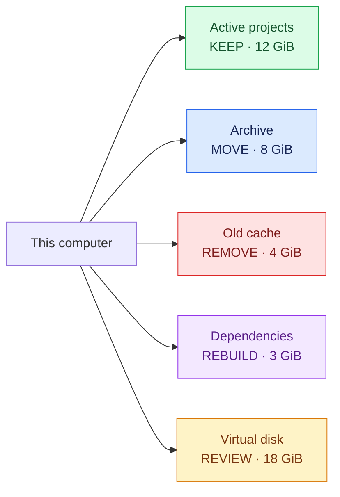

# Visual storage map

Use a Mermaid `flowchart LR` for a broad audit with several important items. Keep it small enough to read.

## Raw scanner map

The scanner creates `storage-map.mmd`. It shows the largest measured folders and their closest visible parent. Blue means measured storage only. It does not mean safe to remove.

## Final decision map

After the safety review, update or recreate the graph with these decision classes:

Apply these rules:

- Keep the graph to about 20 important nodes. Split it by category if it becomes crowded.
- Put the measured size and decision in every item label.
- Connect a child to the closest parent shown in the graph.
- Use the five words exactly: `KEEP`, `MOVE`, `REMOVE`, `REBUILD`, and `REVIEW`.
- Add a plain-text list or tree when Mermaid cannot render.
- Treat colours as scanning aids. Keep the decision words for accessibility.
- Do not put secret filenames or sensitive full paths in a shared graph.
- Do not imply that a recommendation is approved. Record approval separately.
